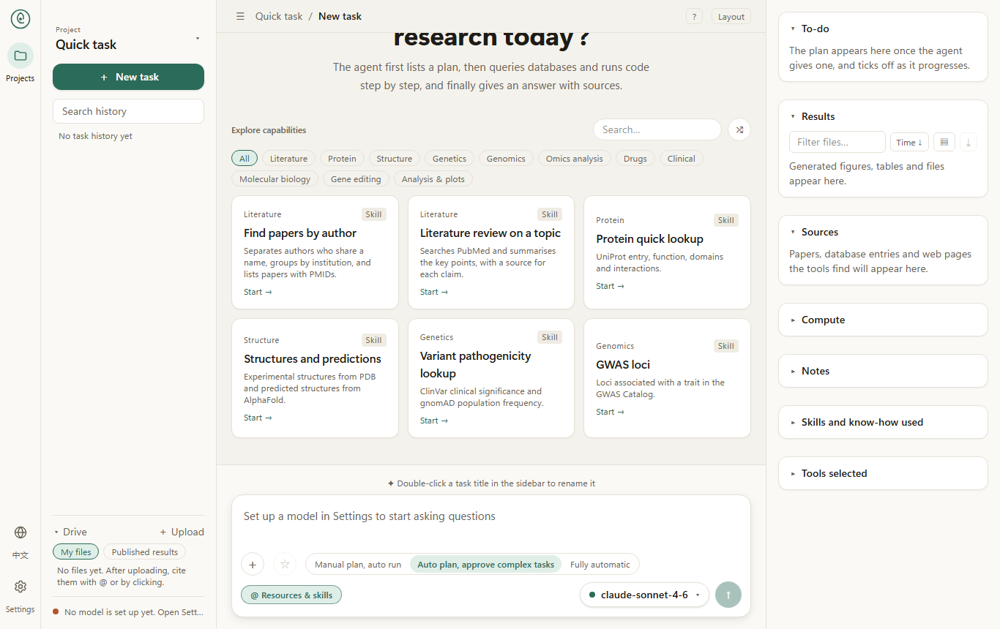
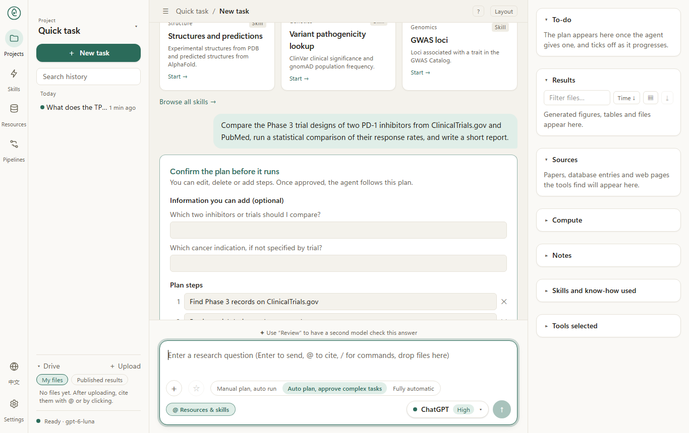
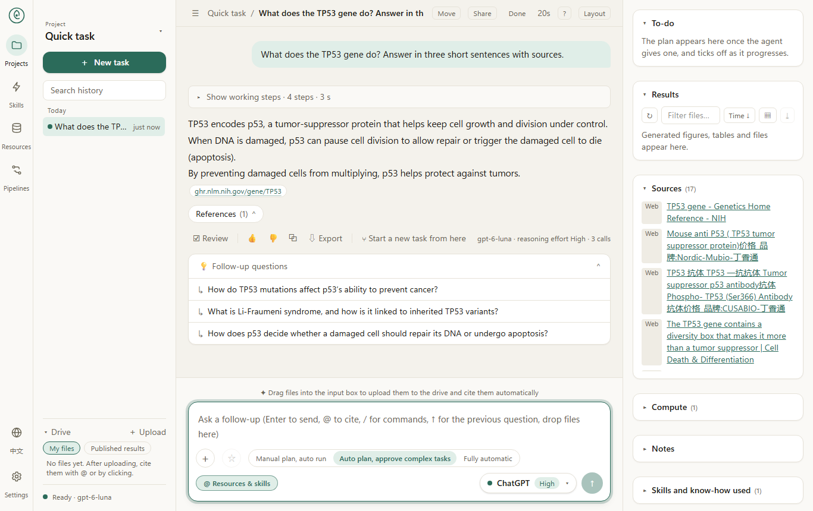

# Micro-Planet Bioscience

**A local research assistant for biomedicine, in English and 中文.** Ask a question in plain language. The agent makes a plan, searches public databases and the literature, runs analysis code, and answers with the sources it actually read. It runs entirely on your own computer.



**[Download the Windows installer (v0.1.1)](https://github.com/h7156318030/Micro-Planet-Bioscience/releases/latest)** · [Release notes and product introduction](https://github.com/h7156318030/Micro-Planet-Bioscience/releases/tag/v0.1.1) · [Illustrated product page](https://claude.ai/artifact/MHsaY93dWC9tznrs6CQoao)

---

## Why Micro-Planet Bioscience

- **It plans before it acts.** Complex questions show a numbered plan and the clarifying questions it needs answered. You approve, edit or skip the plan. Simple questions run at once.
- **You see every step.** Each search, database call, web page and code step appears in the activity log while it runs, with its duration.
- **Every source can be checked.** The *Sources* panel lists each page and record the agent read, including low-quality ones. A citation audit flags any PMID, DOI, NCT number or URL that the agent did not actually see in a tool result.
- **It works with the models you choose.** Log in with a ChatGPT subscription, or add any OpenAI-compatible provider (16 presets, including Ollama and LM Studio for models on your own computer). Free Kilo Gateway models work out of the box with no account.
- **It runs several tasks at once.** Four tasks can run in parallel by default. A conversation stays with the process that holds its memory, and each conversation has its own Python session.
- **Your data stays on your computer.** Conversations, results, settings and keys are stored locally. Only model requests and database queries leave the machine. You can export or clear everything in Settings.

## How it differs from open-source Biomni

Micro-Planet Bioscience is built on [Biomni](https://github.com/snap-stanford/Biomni) (Apache-2.0), a general biomedical AI agent from Stanford's SNAP lab. We kept Biomni's tool library and its approach of choosing tools and running Python, and added a complete application around it.

| | Open-source Biomni | Micro-Planet Bioscience |
|---|---|---|
| **Form** | Python package with a demo interface | Desktop app for Windows, or a local web app; one-click installer |
| **Interface** | No full application | Chinese and English, switchable any time. Chat, history, projects, settings, skills, shareable result pages |
| **Agent engine** | Fixed Biomni workflow | Our own agent loop: the model chooses its tools, thinks as long as it needs, and stops when it has answered. Biomni's agent remains as a fallback |
| **Thinking effort** | — | Judged per task: a quick check rates the question and sets the depth of thinking. You set the ceiling |
| **Literature research** | One search | Research lane: several searches in parallel, the best pages read, one cited answer written |
| **Planning** | Automatic | Three modes: approve every plan, approve complex tasks (default), or fully automatic |
| **Models** | Set when the agent is created | Add, test and switch providers in the interface. ChatGPT subscription login. Reasoning level per model. Paid models need your confirmation |
| **Concurrency** | One task at a time | Several tasks at once: the server's agent plus three worker processes |
| **Sessions** | — | Projects, conversation history, stored conversations, tasks and events, a Python session per conversation |
| **Tools** | Biomni tool library | 225 bundled tools in 20+ modules, a fast database layer (one call in 1–3 s, with a short cache), web search without an API key, PDF reading, ToolUniverse, two repaired upstream tools, and a switch for each database |
| **Skills** | A few know-how documents | 98 built-in skills in 15 fields, each with when to use it, steps, tools and quality checks. Write your own in the Skills page |
| **Evidence** | Outputs and tool calls | Citation audit, second-opinion review, three suggested follow-up questions, a sources panel |
| **Memory** | — | *Remember …* keeps an instruction for later tasks; only you can add one |
| **Outputs** | Agent output | Results folder per conversation, charts, reports (Markdown and a self-contained HTML page with a check table), slide decks, shareable pages, export to text or PDF |
| **Quality control** | — | A fixed answer-quality benchmark (`evalbench`), tool smoke tests, 53 test files |

## What you can do

- **Literature:** PubMed, Europe PMC (including preprints), Crossref, OpenAlex, ORCID, Zenodo, Semantic Scholar; find papers by author with name disambiguation; read abstracts and PDFs.
- **Genes and proteins:** UniProt, Ensembl, ClinVar, gnomAD constraint, GTEx tissue expression, STRING and Reactome interactions, CIViC cancer variants.
- **Drugs and clinical:** ChEMBL compound activity, Open Targets, target druggability, openFDA adverse events, ClinicalTrials.gov.
- **Omics and sequencing:** GEO dataset search, ENA sequencing runs with download commands, scanpy and DESeq2 workflows, pathway enrichment.
- **Analysis:** a Python session that keeps variables between steps, tested helpers for survival, meta-analysis, power and primer design, and charts.
- **Deliverables:** figures, tables, reports with sources, slide decks, and result pages you can share.

## Screens

| Plan review for a complex question | A finished answer with sources |
|---|---|
|  |  |

---

## Install

### Windows (recommended)

1. Download `MicroPlanetBioscience-Setup-0.1.1.exe` from the [latest release](https://github.com/h7156318030/Micro-Planet-Bioscience/releases/latest) (about 148 MB, Windows 10 or 11).
2. Run it. It installs for the current user only, so no administrator rights are needed.
3. Open **Micro-Planet Bioscience** from the Start menu and answer the Kilo question on the first chat screen.

The installer is not code-signed, so Windows SmartScreen may show a warning. Choose *More info* → *Run anyway*.

### From source (Windows, macOS or Linux)

Requirements: Python 3.12, Node.js 20 or newer.

**Windows:** double-click `install.bat`, then `start.bat`. Close the two Micro-Planet Bioscience windows to stop.

**macOS or Linux:**

```bash
./install.sh
./start.sh
./stop.sh
```

Pass `--core` (or `-Core` on Windows) to skip the large analysis packages (scanpy, rdkit and others). The first installation takes several minutes. Then open http://localhost:3001 and wait until the bottom-left corner says *Ready*. The agent takes about a minute to load after start-up.

## First run: set up a model

Until a model is set up, the page says *No model is set up yet*. Then:

1. Open **Settings → Models**.
2. Either click **Log in to ChatGPT** and follow the code shown, or add a provider and paste its API key.
3. Choose the model you want to use.

Keys and the ChatGPT login are stored only on your computer. `.env.example` lists optional environment variables if you prefer to set keys that way.

## Documentation

- [Product guide](docs/GUIDE.md): features, how a task runs, a tour of every page, tools, skills, models, privacy and limits.
- [Product introduction](docs/PRODUCT_INTRO.md): what we changed from Biomni, and the comparison table.
- [Skill catalogue](docs/SKILLS.md): all 98 built-in skills, grouped by field.
- [Tool catalogue](docs/TOOLS.md): all 225 bundled tools, grouped by module.
- [Release notes](https://github.com/h7156318030/Micro-Planet-Bioscience/releases): what changed in each version.

## Limits

- Public databases and literature services sometimes fail or rate-limit. When PubMed is unavailable, the search falls back to Europe PMC and the answer says so.
- Web search can return low-quality pages. Check important results against the primary sources the answer cites.
- Free Kilo models come from third parties and can be rate-limited or unavailable.
- Outputs are research aids, not medical advice.
- Some tools need extra software or data on your computer. The **Resources** page shows what is ready.

## Development

- Backend: `biomni_ui/` (FastAPI). Run it with `python -m biomni_ui.server`.
- Web app: `web/` (Next.js). Build with `npm run build` in `web/`.
- Tests: `python -m unittest discover -s biomni_ui -t . -p "test_*.py"`.
- Benchmark: `python -m biomni_ui.evalbench run <label>` runs the fixed questions against a running service.

---

## 简体中文简介

**Micro-Planet Bioscience 是一个在你自己电脑上运行的生物医学研究助手，界面支持中英文切换。**

你用自然语言提问，智能体会先列出计划（复杂任务需要你确认），再查询公共数据库与文献、运行分析代码，最后给出答案和可核对的来源。对话、结果、设置和密钥都保存在你自己的电脑上。

**主要特点：**

- **先计划，后执行**：复杂问题展示编号计划和需要你回答的澄清问题，可批准、修改或跳过。
- **每一步可见**：搜索、数据库调用、网页和代码步骤实时显示，并标注耗时。
- **来源可核对**：来源面板列出智能体读过的每个页面和记录；引用审计会标出回答中未出现在工具结果里的 PMID、DOI、NCT 号和网址。
- **模型自由选择**：可用 ChatGPT 订阅登录，也可添加任意 OpenAI 兼容服务商（内置 16 个预设，包括本机的 Ollama 和 LM Studio）；安装包内置 Kilo 免费模型，无需账号。
- **多任务并行**：默认可同时运行 4 个任务，每个对话有独立的 Python 会话。
- **数据留在本机**：对话、结果、设置和密钥都存在本地，设置中可导出或清空全部数据。

**与开源 Biomni 的主要区别：** 我们保留了 Biomni 的工具库和“按需选工具、用 Python 执行”的思路，并在其上增加了完整的应用：Windows 安装包与桌面窗口；中英文界面；自研的智能体循环（模型自己决定调用什么工具、何时结束），Biomni 的智能体作为备用保留；按任务难度分级思考；多路并行的文献研究；可在界面中管理的多服务商与 ChatGPT 登录；并发任务、项目与会话管理；225 个工具（含 1–3 秒的快速数据库层）；98 个技能；引用审计、第二意见审查和“记住”指令；图表、报告、幻灯片与结果分享页面。

安装与使用请见上文，图文详解见 [docs/GUIDE.md](docs/GUIDE.md)，完整对比见 [docs/PRODUCT_INTRO.md](docs/PRODUCT_INTRO.md)。

---

## License

Apache-2.0. See `LICENSE`. Micro-Planet Bioscience is built on [Biomni](https://github.com/snap-stanford/biomni); the original project's license and attribution are kept.
