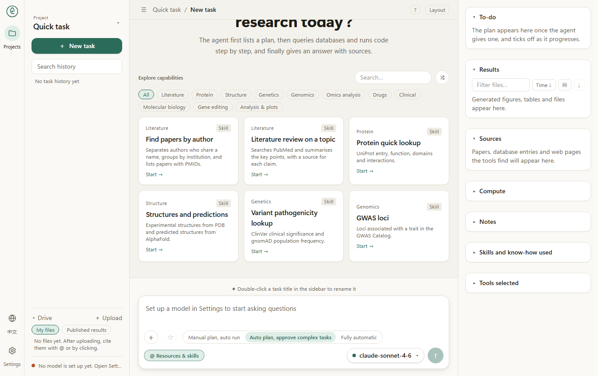
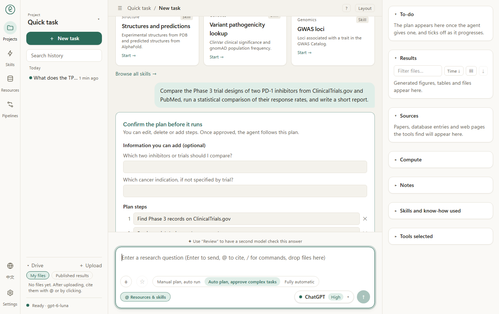
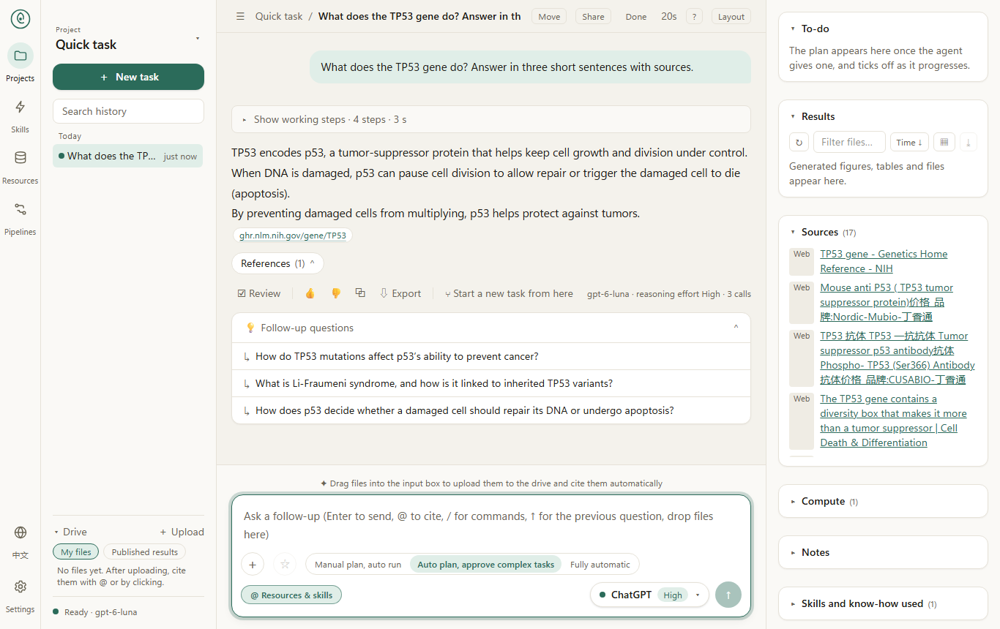

# Micro-Planet Bioscience：产品介绍

> 图文在线版（含同样的对比表）：<https://claude.ai/artifact/MHsaY93dWC9tznrs6CQoao>

**一句话：** 一个在你自己电脑上运行的生物医学研究助手。你用自然语言提问，智能体先列出计划，再检索文献和数据库、运行分析代码，最后给出答案，并标明它实际读取过的来源。



---

## 1. 基于 Biomni 开源项目升级

Micro-Planet Bioscience 建立在斯坦福大学 SNAP 实验室开源的 **Biomni** 之上（Apache-2.0 许可证）。Biomni 是一个通用生物医学 AI 智能体：它会挑选工具、规划任务，并用 Python 执行代码。

我们保留了 Biomni 的智能体核心和工具库，并在它之上做了几方面升级：

- **从代码库变成可直接使用的桌面式应用**：网页界面、中英文切换、一键安装和启动脚本。
- **多模型接入**：ChatGPT 订阅登录，或任意 OpenAI 兼容的服务商，都可以在界面里添加、测试和切换。
- **执行过程可控**：三种计划模式，付费模型调用前需要确认，回答列出实际使用的来源。
- **按需取数据**：数据文件用到时再下载，不需要一开始就下载整个数据湖。
- **项目化工作**：项目、对话历史、上传文件、结果分享。

Biomni 开源项目：<https://github.com/snap-stanford/Biomni>，论文：<https://pubmed.ncbi.nlm.nih.gov/40501924/>。

---

## 2. 界面一览

| 计划审阅：复杂问题先给出计划，等你批准 | 回答：附带实际读取的来源 |
|---|---|
|  |  |


系统结构见 [architecture](images/architecture.svg)。

---

## 3. 关键对比：开源 Biomni 与 Micro-Planet Bioscience

对比基于两者的公开文档和本仓库代码。开源项目还在更新，遇到出入时请以其官方文档为准。

| 维度 | 开源 Biomni | Micro-Planet Bioscience |
|---|---|---|
| 使用形态 | Python 包（pip 或 GitHub 安装），另有 Gradio 演示界面；官方还提供托管的无代码网页 | 本地网页应用，在自己的电脑上运行，`start.bat` / `start.sh` 启动 |
| 安装 | `pip install` | `install.bat` / `install.sh` 一键安装，可用 `--core` 跳过大型分析包 |
| 界面语言 | 英文 | 中英文即时切换 |
| 模型接入 | 创建智能体时指定 LLM | 界面内添加服务商（任意 OpenAI 兼容接口）、测试连接、切换模型；支持 ChatGPT 订阅登录 |
| 付费模型 | 开源版文档中未提供此功能 | 付费模型有明确标注，调用和测试前需要确认 |
| 推理强度 | 开源版文档中未提供界面控制 | 每个模型可在界面中调整推理强度 |
| 规划与执行 | 自适应规划循环，自动执行 | 三种模式：手动批准计划 / 复杂任务先批准 / 全自动 |
| 来源 | 输出结果和工具调用 | 回答列出实际读取的页面与数据库记录，引文可点击查看原始来源 |
| 数据文件 | 官方说明：首次运行时下载数据湖（旧版约 11 GB，请以当前文档为准） | 用到哪个数据文件才下载（`download_data_lake_file`） |
| 技能与知识 | `biomni/know_how` 中的少量知识文档 | 98 个技能手册，可在项目中选用 |
| 工作组织 | 以单次 Python 会话为主 | 项目、对话历史、上传文件、`@` 引用、结果分享页面 |
| 数据与隐私 | 本地运行 | 对话、结果和密钥只保存在本机；设置中可导出或清空全部数据 |

---

## 4. 快速开始

**Windows：** 双击 `install.bat` 安装，然后双击 `start.bat` 启动。关闭两个窗口即可停止。

**macOS / Linux：**

```bash
./install.sh
./start.sh
./stop.sh
```

首次打开后，到 **设置 → 模型** 登录 ChatGPT，或添加一个服务商并填入 API Key。

---

## 5. 版本说明

本版本（**v0.1 精简版**）保留以下核心功能：对话与计划执行、模型与服务商管理、项目与历史、上传与结果分享、数据设置。

以下功能不在本版本中：技能库的图形化编辑、资源清单页面、流程（Pipelines）页面，以及记忆条目和连接器的管理界面。后续版本会按阶段逐步增加功能，每个阶段的变化单独记录。

---

## 6. 许可与致谢

Apache-2.0，见 [LICENSE](../LICENSE)。Micro-Planet Bioscience 建立在 [Biomni](https://github.com/snap-stanford/Biomni) 之上，原项目的许可证和署名予以保留。
